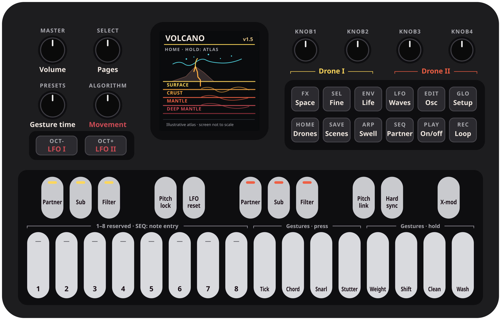

# Niagara Drift · VOLCANO v1.5

**A two-drone synthesizer for the M-VAVE FM-1.**

VOLCANO v1.5 gives Niagara Drift a geological interface. The instrument's
two always-on drones retain the v1.4 synthesis engine, modulation, sequencing,
scenes, and effects; the display now shows the sound through animated volcanic
strata, oscilloscopic and filter-response traces, ash and smoke, orbital scene
navigation, and a planetary stereo display.

This is a [custom fork](https://github.com/oliolioxinfrii/niagara-drift)
of [evanyerburgh/niagara-drift](https://github.com/evanyerburgh/niagara-drift),
not an official upstream firmware release. This README describes
[`feature/volcano-v1.5-ui`](https://github.com/oliolioxinfrii/niagara-drift/tree/feature/volcano-v1.5-ui).
The v1.5 interface was subsequently merged into `main`; development and
bug fixes may continue on other branches.



*VOLCANO v1.5 control map (illustration; the center display is a schematic
geological atlas, not an emulator screenshot). The physical panel labels appear
above each control, and its usual function appears below. Drone I is yellow;
Drone II is lava red. White keys 1–8 are reserved on normal pages and enter
notes on the sequencer's note-entry page; keys 9–16 control gestures.*

### Navigating VOLCANO

- **SELECT encoder:** turn to cycle through pages within the active button's
  page family. Hold **SEL** while turning SELECT to adjust the LFO rate.
  Press a page button to open its family, then tap again to cycle its pages.
- **HOME:** Drones and Pitch. Hold HOME for 400 ms to view the five-layer
  activity atlas temporarily; release to return to the previous view.
  **SEL + HOME** generates a randomized sound and sequencer.
- **SAVE:** open the orbital scene browser. **KNOB 1** selects a bank,
  **KNOB 2** a slot, **KNOB 3** Save / Load / Transition, and **KNOB 4**
  the transition percentage. Press **SAVE** to confirm, **HOME** to go back,
  and **REC** to rename a user slot. Presets cannot be overwritten.
- **Page families:** ENV Life / Tone; EDIT Osc / Sub · Drive;
  LFO Waves / Sends / Mods; SEQ Partner / Pitch moves / Sequence /
  Intervals / Transitions; ARP Swell / Swell shape; FX Space / Details;
  GLO Setup 1 / Setup 2.
- **Keys:** the black keys control oscillator, filter, link, and LFO
  functions (with context-sensitive LFO routing on the LFO pages).
  The last eight white keys activate Tick, Chord, Snarl, Stutter,
  Weight, Shift, Clean, and Wash. The first eight white keys are
  not scene recall buttons in v1.5.

### Five layers of the interface

The page colors identify *interface contexts*, not independent sound engines:
**Atmosphere** (cyan: FX), **Surface** (sulfur yellow: HOME), **Crust**
(orange: SEQ and ARP), **Mantle** (orange-red: EDIT and ENV), and
**Deep Mantle** (red: LFO). SAVE uses a separate orbital memory browser;
GLO includes time settings and the stereo-orbit planet.

The activity atlas reflects effects, drone levels, rhythmic movement,
feedback and drift, and LFO modulation. It is a visual representation
of instrument state rather than a geophysical measurement.

**Status:** The v1.5 UI was merged into `main` on November 16, 2026;
the merge commit reports a successful host test suite and installation
on a physical FM-1. The older [v1.5 design specification](docs/volcano-v1.5-ui.md)
retains its pre-verification status text. Check the branch and commit you
intend to build, particularly while subsequent fixes are in progress.
The [upstream online emulator](https://evanyerburgh.github.io/niagara-drift/)
runs the original project, **not this fork**. Build the local emulator with
`sh web/emu/build.sh`, then serve `build/emu` to inspect this source.

## What it does

- **Two always-on drones:** each blends sine, triangle, saw, and square
  oscillator shapes with a partner oscillator, sub oscillator or
  subharmonic, noise, a resonant filter, and drive. Pitch is continuously
  adjustable between notes.
- **Motion and modulation:** independent drone controls, two LFO waveforms
  with routing and depth, Swell envelopes, Drift, Wander, Age, pitch
  linking, hard sync, and cross-modulation.
- **Sixteen factory presets and 48 user scenes:** browse two immutable
  preset banks and six writable user banks using SAVE. Each user scene
  slot can have its own name. Load a scene, save a new one, or transition
  partway toward it over the Scene time.
- **Eight playable gestures:** Tick, Chord, Snarl, Stutter, Weight,
  Shift, Clean, and Wash affect several parameters at once. The
  first four respond to pressure; the latter four to holds and taps.
- **Pitch sequencing:** one to four pitches per drone, independently
  positioned events, drone II phase offset, and a separate Transitions
  page for shaping the movement between pitches.
- **Effects and feedback:** stereo delay, drive after the delay, reverb,
  Feedback, Character, and a Motion Loop for recording and repeating
  manual changes.
- **VOLCANO visualizations:** volcanic strata on HOME, a plume and ash
  observatory on ENV, warm oscillator and sequencer graphics, a
  geological activity atlas on HOME hold, orbital scene navigation,
  and planet/orbit stereo visualization on GLO.

### Sequencing in v1.5

SEQ cycles through **Partner**, **Pitch moves**, **Sequence**,
**Intervals**, and **Transitions**. The Sequence page edits up to
four notes per drone. Intervals adjusts when events occur within
the loop, and Transitions adjusts the shape of the four successive
pitch changes (including the return to step 1).

**SEL + PLAY** controls pitch-sequencer transport without changing the
global PLAY fade. **SEL + HOME** randomizes the working sound and
sequence, including transition shapes. The sequencer is held in RAM;
its notes and timing are not stored in scene slots.

## Installing this custom build

This fork's installer package is built locally; the original creator's website and GitHub releases
serve **their** firmware, not this fork. To build the exact source on this branch,
see [BUILDING.md](BUILDING.md):

```sh
./build.sh
tests/run_tests.sh
```

The installable file is `build/omni.fwsc`. Keep a previously working package and a
stock-firmware recovery route. For the firmware build you need the JieLi toolchain and AC79 SDK;
see [BUILDING.md](BUILDING.md). To install on a physical FM-1, use
[Slipway](https://discodave-glitch.github.io/slipway/app/) to select the local `.fwsc`
package, or use the bundled CLI (`pip install mido python-rtmidi`):

```sh
python3 tools/fm1_install.py build/omni.fwsc
```

No custom firmware binary has been published as a release from this fork.

**What it replaces:** Niagara Drift replaces M-VAVE's original sound engine and sequencer.
The custom firmware includes its own two-drone pitch sequencer; it is not the stock FM-1
sequencer.

**Updating:** when there's a new version, run the installer again the same way. Your sound and scenes are
kept, unless that version's notes in the [changelog](CHANGELOG.md) say otherwise.

**Backing up, going back to M-VAVE's firmware, and when an install doesn't take:** see
[Help](docs/manual/help.md). Installing firmware is at your own risk.

## Manual

- [Start here](docs/manual/index.md): the manual for the source in this fork
- [Recipes](docs/manual/recipes/index.md): how to get a sound or a move, across the pages
- [Reference](docs/manual/reference/index.md): every page, knob and key
- [Shortcuts](docs/manual/reference/shortcuts.md): every key combination, hold and tap
- [Help](docs/manual/help.md): installing, backing up, going back, problems

The [creator's site](https://evanyerburgh.github.io/niagara-drift/) provides the upstream
emulator and manual, which may differ from this custom firmware. Build this repository's web
emulator to inspect its current UI.

## Problems and ideas

For problems specific to this custom firmware, use the
[issues in this fork](https://github.com/oliolioxinfrii/niagara-drift/issues).
For general upstream issues, consult the [original repository](https://github.com/evanyerburgh/niagara-drift).
Include the commit or branch, the firmware identity, and the steps to reproduce.

## Building and testing

See [BUILDING.md](BUILDING.md) for the toolchain, including the extra steps on a Mac.

```
tests/run_tests.sh      # the instrument, the platform pieces, the app in a simulator
./emulator.command      # the same code in the browser: builds it, serves it, opens it
./build.sh              # build/omni.fwsc, the installable firmware
```

`build/host/omni_host SCRIPT OUTDIR` runs the whole app on a computer from a script
(`tests/scenarios/*.omni`), writing audio and screenshots. `python3 tools/make_screens.py` regenerates the host-simulator page images
(`docs/img/page-*.png`) from `tests/scenarios/pages.omni`. The v1.5
control map at the top of this README is the separate, editable
`docs/img/panel-v15.svg` illustration. The manual's pages are Markdown in `docs/manual`;
`python3 tools/make_manual.py OUT` makes them into the site's pages (the emulator's build does), and
`python3 tools/make_manual.py --renders` remakes each recipe's screens and sound from its script in
`docs/manual/renders`.

Installing firmware is at your own risk. Before installing a development build, make sure you can
put M-VAVE's firmware back (see BUILDING.md).

## Credits

Niagara Drift is the next link in a chain of FM-1 firmwares:

- [Felucca](https://github.com/hugelton/Felucca) by Leo Kuroshita (Hügelton Instruments): the
  platform (hardware layer, USB, update loader, storage, installer), and a reference for the
  sound engine.
- [X0X](https://github.com/charlesvestal/fm1-x0x) and [FoMni](https://github.com/charlesvestal/fm1-fomni)
  by Charles Vestal: the platform reshaped for a single instrument, the host simulator and the
  browser emulator. Niagara Drift started from FoMni's code.
- [MONK-1](https://github.com/charlesvestal/fm1-monk) by Charles Vestal: reading key pressure (from
  [Velo](https://github.com/charlesvestal/fm1-velocity)'s sensing), which plays the scene crossfade.
- [ChoralRoot](https://github.com/Quixotic7/ChoralRootFM1) by Quixotic7: the design of the delay and the
  reverb, written anew here; the idea of crossfading between scenes, and of a backup before installing.
- [fm1-base](https://github.com/charlesvestal/fm1-base) by Charles Vestal: the safe restore's flash core (staging,
  the journal, the commit and its finish at power-on), as it is there (MPL-2.0).
- The [FM-1 Screen Reader](https://github.com/charlesvestal/fm1-reader) by Charles Vestal: the screen's words over
  USB and the page that speaks them (its firmware side from fm1-base, MPL-2.0); thanks to João Durães (WoodJack) for
  asking for it.

It began from ideas in the Stylophone CPM DS-2, the Moog Subharmonicon and the Soma Lyra-8.

GPL-3.0-only (the files from fm1-base keep their MPL-2.0); see [LICENSING.md](LICENSING.md).

Niagara Drift isn't affiliated with or endorsed by M-VAVE, Hügelton Instruments or the makers of any
instrument that inspired it.
